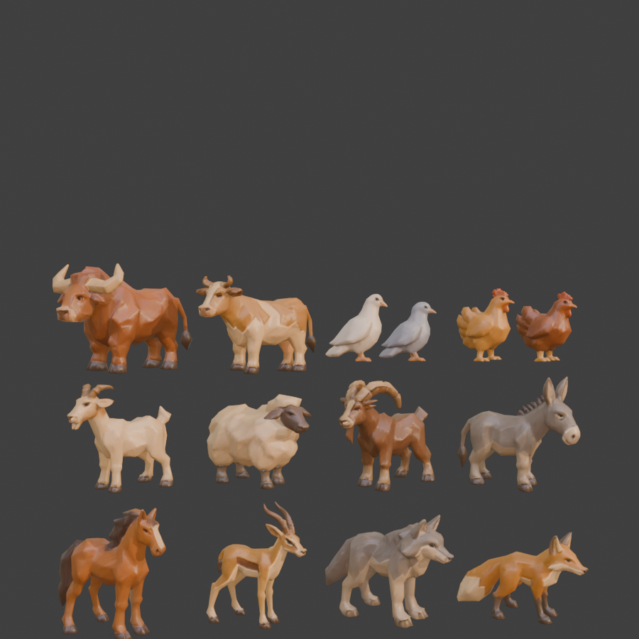

# Animais (provisórios)

Catorze animais gerados no Tripo, separados um a um no Blender, em escala real e com um esqueleto simples para animação. São provisórios: servem para povoar a vila enquanto não há versões definitivas.

| Arquivo | Animal | Altura total | Triângulos | GLB |
| --- | --- | --- | --- | --- |
| `boi.glb` | boi | 1,65 m (com chifres) | 15.334 | 641 KB |
| `vaca.glb` | vaca | 1,45 m | 10.076 | 456 KB |
| `cavalo.glb` | cavalo | 1,75 m | 9.314 | 421 KB |
| `jumento.glb` | jumento | 1,35 m (com orelhas) | 8.372 | 392 KB |
| `cabra.glb` | cabra | 0,95 m | 9.068 | 440 KB |
| `ovelha.glb` | ovelha | 0,95 m | 11.180 | 487 KB |
| `ibex.glb` | íbex (cabrito-montês) | 1,15 m (com chifres) | 9.983 | 470 KB |
| `gazela.glb` | gazela | 1,15 m (com chifres) | 5.623 | 313 KB |
| `lobo.glb` | lobo | 0,85 m | 9.208 | 413 KB |
| `raposa.glb` | raposa | 0,48 m | 6.305 | 274 KB |
| `galinha1.glb` | galinha clara | 0,42 m | 4.366 | 200 KB |
| `galinha2.glb` | galinha ruiva | 0,42 m | 4.698 | 211 KB |
| `pomba1.glb` | pomba branca | 0,24 m | 4.382 | 195 KB |
| `pomba2.glb` | pomba cinza | 0,24 m | 4.116 | 183 KB |

## Como usar

- Origem nos pés, metros, cabeça para +Z no three.js (mesma frente dos NPCs e do discípulo).
- Uma malha com textura própria em WebP (cor 1024 px nos grandes e 512 px nos pequenos, mais mapa de normais com a metade), sem meshopt.
- Esqueleto simples: quadrúpedes com 14 ossos (raiz, quadril, coluna, pescoço, cabeça, rabo e quatro patas de dois ossos); aves com 10.
- Animações (clips do glTF):
  - `Parado`: respiração, cabeça olhando em volta e rabo balançando.
  - `Andar`: passo no lugar (patas em diagonal; aves gingando). A velocidade de deslocamento sugerida está no `index.html`.
  - `Comer`: herbívoros pastam, aves bicam, lobo e raposa farejam.

## Limitações conhecidas

- Os animais altos (cavalo, boi, vaca) baixam a cabeça para pastar, mas o focinho não chega ao chão: o pescoço do modelo é curto.
- Rig automático e animação procedural: bom de longe e a média distância; de perto, as dobras das patas são simples.

