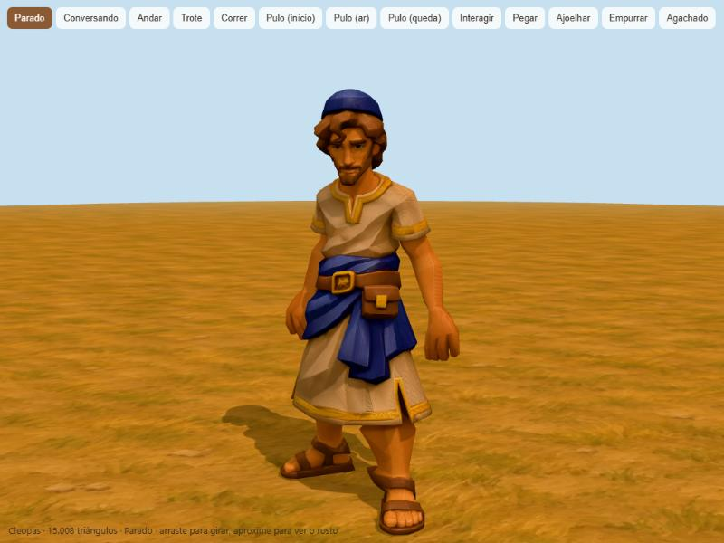

# Cleopas

O discípulo de azul que acompanha o jogador no caminho de Emaús (substitui a versão anterior). Modelo do Tripo sem esqueleto, montado no Blender no mesmo esqueleto e nas mesmas animações do discípulo jogável.

| | Cleopas | Discípulo jogável |
| --- | --- | --- |
| Triângulos | 15.008 | 14.207 |
| Esqueleto | 65 ossos (Universal Animation Library) | o mesmo |
| Animações | 13 | 13 |
| Textura | só cor, 2048 px, WebP (373 KB) | só cor, WebP |
| GLB | 1,4 MB | 2,2 MB |

## Como foi feito

- **Rosto em detalhe, corpo leve:** a cabeça (rosto, cabelo e barba) manteve os 8.320 triângulos do original; só o corpo foi reduzido (de 39.600 para cerca de 6.700). Na textura, as ilhas do rosto receberam 2,6 vezes mais espaço que o resto.
- **Esqueleto e pesos:** encaixe medido da malha, pesos automáticos, cabeça rígida do queixo para cima, sandálias separadas e mãos viradas para o corpo.
- **Material igual ao do jogador:** só cor, metal 0, rugosidade 0,5, dois lados, sem meshopt.

## Animações

`Parado`, `Conversando`, `Andar`, `Trote`, `Correr`, `Pulo_Inicio`, `Pulo_Ar`, `Pulo_Queda`, `Interagir`, `Pegar`, `Ajoelhar`, `Empurrar`, `Agachado` — os mesmos nomes do `vila-betania/discipulo_acoes.glb`, então o mesmo código de animação serve para os dois.

Origem nos pés, 1,72 m de altura, de frente para +Z no three.js.

