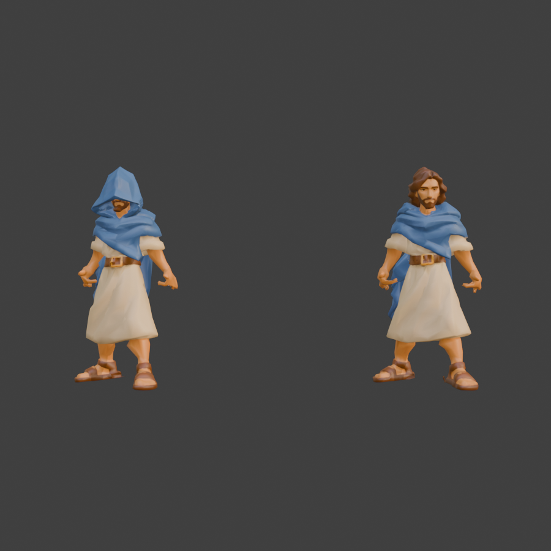

# Jesus

Jesus em duas versões, para o caminho de Emaús: `jesus.glb` (normal) e `oculto.glb` (o estranho com capuz, antes de ser reconhecido). Modelo do Tripo com as duas figuras lado a lado, separado e convertido no Blender para o mesmo esqueleto e as mesmas animações do discípulo jogável e do Cleopas.

| | Jesus | Estranho oculto | Discípulo jogável |
| --- | --- | --- | --- |
| Triângulos | 14.220 (original 56.272) | 14.186 (original 59.056) | 14.207 |
| Triângulos da cabeça | 5.657 de 5.667 | 6.488 de 6.488 | — |
| Esqueleto | 65 ossos (Universal Animation Library) | o mesmo | o mesmo |
| Animações | 13 | 13 | 13 |
| Textura | só cor, 2048 px, WebP | só cor, 2048 px, WebP | só cor, WebP |
| GLB | 1,2 MB | 1,2 MB | 2,2 MB |

Altura 1,76 m (os discípulos têm 1,70 m), origem nos pés, de frente para +Z no three.js.

## Como foi feito

- **Rosto preservado:** a cabeça foi protegida na redução de triângulos; só o corpo foi simplificado. Na textura, as ilhas do rosto têm 2,6 vezes mais espaço que o resto.
- **Cabeça rígida:** do queixo para cima (barba e mandíbula incluídas) tudo segue só o osso `Head`; a transição para o pescoço fica no cilindro do pescoço, entre a gola e o queixo. Assim o rosto não entorta em nenhuma animação.
- **Pose do jogador:** os braços abertos do modelo foram baixados para a pose de descanso do jogador, com o punho girado e os dedos levemente fechados, para as mãos ficarem rentes ao corpo.
- **Pés separados:** as sandálias, que se tocavam no modelo, foram cortadas uma da outra e cada uma segue só o seu pé.

## Animações

`Parado`, `Conversando`, `Andar`, `Trote`, `Correr`, `Pulo_Inicio`, `Pulo_Ar`, `Pulo_Queda`, `Interagir`, `Pegar`, `Ajoelhar`, `Empurrar`, `Agachado` — os mesmos nomes do discípulo jogável e do Cleopas.

