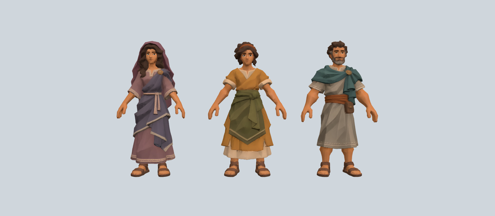
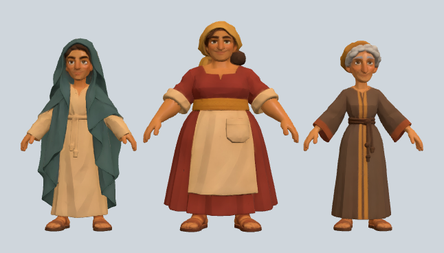
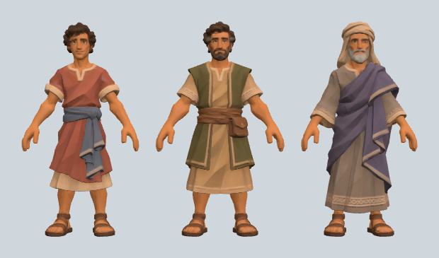
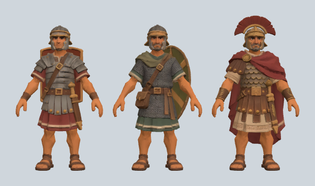
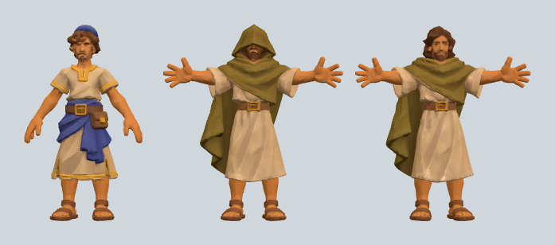

# Personagens provisórios (para modelar depois no Blender)

Modelos **provisórios**, guardados aqui para serem retrabalhados no computador local com o Blender. Não fazem parte do jogo publicado e não estão ligados ao índice do site.

Todos vieram do Tripo (exportação GLB). Cada arquivo é **uma única malha com três figuras lado a lado**, em pose A, normalizada em cerca de 1 m de largura. Nenhum tem esqueleto (rig) nem animações. As proporções abaixo são do conjunto, não de cada figura.

| Arquivo | Conteúdo (da esquerda para a direita) | Triângulos | Tamanho |
| --- | --- | --- | --- |
| `maria_marta_lazaro_tripo.glb` | Maria (véu e manto roxos), Marta (túnica ocre, avental verde), Lázaro (barba, manto verde-azulado) | 44.150 | 3,9 MB |
| `mulheres_tripo.glb` | jovem de véu verde-azulado e túnica clara; mulher robusta de vestido vermelho, avental e lenço amarelo; anciã de cabelo grisalho e túnica marrom | 57.862 | 3,7 MB |
| `homens_tripo.glb` | jovem de túnica vermelha e faixa cinza; homem barbado de colete verde e bolsa; ancião de turbante e manto roxo | 58.042 | 4,4 MB |
| `soldados_romanos_tripo.glb` | legionário (armadura de placas, escudo); auxiliar (cota de malha, escudo redondo); centurião (elmo com crista e capa vermelha) | 58.986 | 4,7 MB |
| `viajantes_capa_tripo.glb` | jovem de barrete azul e faixa azul; viajante de capa oliva com capuz, braços abertos; viajante de capa oliva sem capuz, barba e cabelo longo, braços abertos | 56.998 | 3,9 MB |

Prévias: `previa_*.png`, uma por arquivo.

## Próximos passos no Blender

1. Separar cada malha em três objetos por partes soltas e nomear cada personagem.
2. Reescalar para a altura do jogo (o discípulo do jogo mede cerca de 1,70 m). Os viajantes de capa têm os braços abertos; vale reposicionar para pose A ou T antes de montar o esqueleto.
3. Montar o esqueleto compatível com o do discípulo (Universal Animation Library) para reaproveitar as animações: parado, conversando, andar, trote, correr.
4. Reduzir os triângulos de cada personagem para o orçamento do jogo e exportar em GLB para `assets-vila/`.
