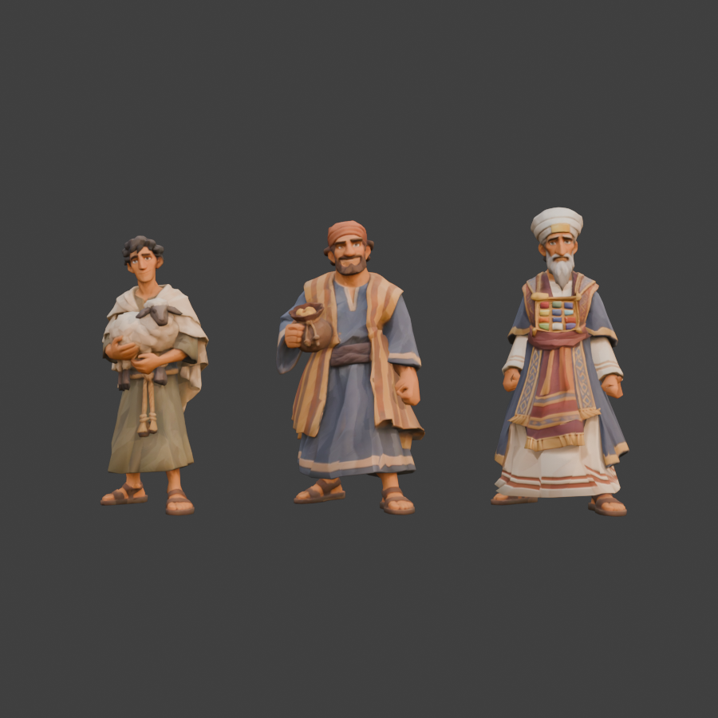

# Personagens (15 NPCs)

Quinze NPCs: pastor, aldeão e sacerdote (um modelo do Tripo) e mais doze de quatro modelos do Tripo com três figuras cada. Cada um foi separado no Blender, reduzido para 15 mil triângulos com a cabeça protegida e montado no mesmo esqueleto do discípulo jogável. Os nomes são provisórios.

| Arquivo | Personagem | Altura | Triângulos | GLB |
| --- | --- | --- | --- | --- |
| `pastor.glb` | jovem pastor com um cordeiro nos braços | 1,62 m | 15.002 | 847 KB |
| `aldeao.glb` | aldeão sorridente com a jarra | 1,70 m | 14.995 | 813 KB |
| `sacerdote.glb` | sacerdote de turbante, barba e peitoral | 1,78 m | 14.996 | 866 KB |
| `rapaz.glb` | rapaz magro de túnica e faixa | 1,61 m | 15.006 | 787 KB |
| `barbudo.glb` | homem barbudo de lenço na cabeça e manto | 1,66 m | 14.998 | 841 KB |
| `escriba.glb` | homem alto de gorro e túnica longa | 1,77 m | 14.995 | 842 KB |
| `robusto.glb` | homem robusto e barbudo | 1,58 m | 15.007 | 818 KB |
| `cacheado.glb` | homem de cabelo cacheado e manto de ombro | 1,71 m | 14.997 | 861 KB |
| `magro.glb` | homem magro de barba e avental | 1,76 m | 14.911 | 802 KB |
| `carregador.glb` | homem careca de túnica curta | 1,57 m | 15.006 | 1,2 MB |
| `moco.glb` | moço de cabelo curto e túnica com faixa | 1,76 m | 14.991 | 1,2 MB |
| `mercador.glb` | mercador de turbante, barba e bolsa | 1,71 m | 14.998 | 1,2 MB |
| `mulher_faixa.glb` | mulher de faixa na cabeça e avental | 1,62 m | 15.006 | 1,2 MB |
| `mulher_lenco.glb` | mulher de lenço, capa curta e bolsinha | 1,50 m | 14.982 | 1,2 MB |
| `mulher_botoes.glb` | mulher de faixa e túnica de botões | 1,62 m | 15.002 | 1,2 MB |

Origem nos pés, de frente para +Z no three.js.

## Como foi feito

- **Rosto preservado:** a cabeça foi protegida na redução; só o corpo e a roupa foram simplificados. Na textura, as ilhas do rosto têm mais espaço que o resto.
- **Esqueleto do jogador:** 65 ossos (Universal Animation Library), com as animações `Parado`, `Conversando`, `Andar`, `Trote` e `Correr`.
- **Cabeça rígida:** do queixo para cima (barba incluída) tudo segue só o osso `Head`, e a transição para o pescoço fica no cilindro do pescoço, para o rosto não entortar.
- **Pés separados:** as sandálias foram cortadas uma da outra e cada uma segue só o seu pé.
- **Medidas:** os doze novos tiveram o encaixe do esqueleto medido da própria malha (pescoço, ombros, braços, pernas, barra da túnica); só as mangas largas do mercador foram ajustadas à mão. Nesses, a parte de trás da cabeça (cabelo) foi reduzida um pouco mais que o rosto, para o corpo ter mais triângulos.
- **Segurando objetos:** no pastor, os dois braços e o cordeiro seguem o peito; no aldeão, o braço da jarra segue o peito e o outro balança; no sacerdote, a barba longa segue a cabeça.
- **Barra da túnica:** no meio da frente e de trás, a barra segue as duas pernas igualmente, para não esticar no passo.
- **Textura:** só cor (1024 px) e mapa de normais (512 px), em WebP, sem meshopt.

O viewer (`index.html`) troca entre os quinze e toca as cinco animações.
